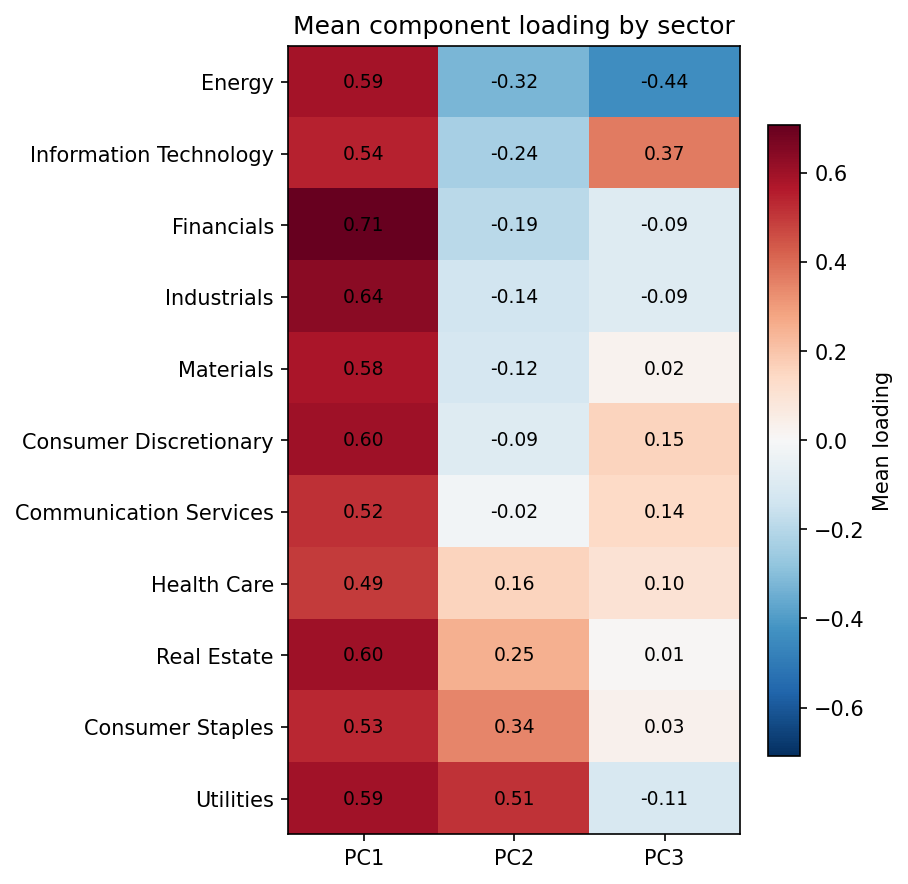
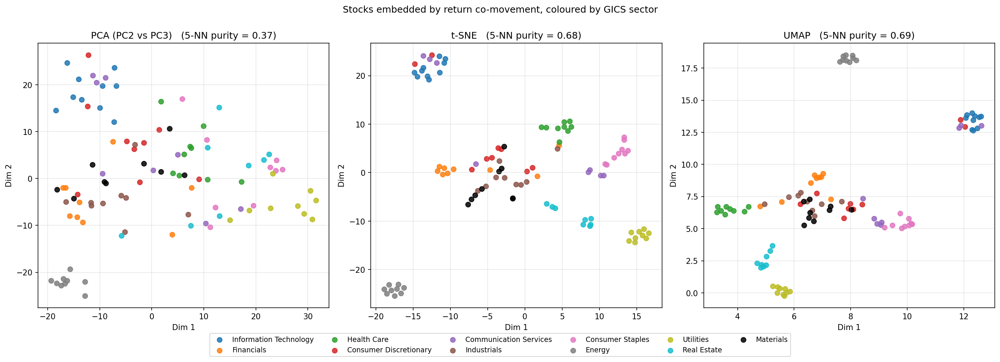

# Market Structure Analysis

This project has two analyses of daily market data from Yahoo Finance. The first takes ten years (May 2016 to May 2026) of 100 of the largest stocks in the S&P 500 across all 11 sectors and uses PCA to see if we can find any patterns within the industries and their historical excess returns. The second focuses on cryptocurrency and tries to predict whether Bitcoin or Ethereum will have the higher return the next day using different machine learning algorithms.

The sector analysis is in [`notebooks/sector_factors.ipynb`](notebooks/sector_factors.ipynb) and the crypto analysis is in [`notebooks/btc_eth_prediction.ipynb`](notebooks/btc_eth_prediction.ipynb).

## Stock Tickers by Sector Excess Return Analysis

The daily closing prices are turned into log returns, and the 13-week T-bill rate is subtracted to get the excess returns. Each stock's excess returns are then standardized so the SVD is actually PCA and the most volatile stocks don't take over the components. EA and AVB are no longer available on Yahoo Finance, so the analysis uses 98 stocks.

The first component explains about 35% of the variance by itself and is the market factor, since every sector loads positively on it. The second component (8.3%) separates the defensive sectors like utilities, consumer staples and real estate from the more cyclical ones like energy, tech and financials, and the third component (5.6%) is mostly tech against energy. All three components have sharp spikes around 2020 (COVID), and the first component also shows more variance during the 2022 Fed rate hikes and a sharp spike in April 2025 from the tariffs.



To compare SVD with t-SNE and UMAP, each stock is represented by its scores on the first 10 components, and the grouping is measured with a 5 nearest neighbor sector purity, which is the fraction of each stock's 5 closest stocks that are in the same sector. The SVD plot shows some sector separation, with utilities and energy on opposite ends of each other, but a lot of the other sectors overlap (purity of 0.37). Both nonlinear embeddings show a lot more cohesion within each sector, with a purity of 0.68 for t-SNE and 0.69 for UMAP compared to about 0.08 if the stocks were grouped randomly. There is still some mixing, since tech and communication services end up together and consumer discretionary is split between AMZN and TSLA and the more traditional retailers. This shows that the overall market dominates most of the movement, but once that is taken out, the sectors are the main structure that is left.



## Ethereum and Bitcoin Return Machine Learning Comparison

The features are the last 7 days of log returns for both BTC and ETH, and the target is whether BTC beats ETH on the next day. The data starts in November 2017 since that is when Yahoo's ETH data begins, and it is split 60/20/20 into train, validation and test in time order. The baseline always predicts what happened more often in the training set, which is BTC outperforming ETH. Logistic regression (with elastic net regularization) and the neural network use features standardized on the training data only, and the hyperparameters are picked using the validation set.

| Model | Train Error | Val Error | Test Error | p (beats baseline) |
|---|---|---|---|---|
| Naive Baseline | 0.475 | 0.444 | 0.447 | – |
| Logistic Regression | 0.468 | 0.439 | 0.463 | 0.80 |
| Random Forest | 0.415 | 0.459 | 0.464 | 0.82 |
| XGBoost | 0.325 | 0.465 | 0.489 | 0.98 |
| Neural Network | 0.422 | 0.477 | 0.463 | 0.80 |

None of the models outperform the baseline, and none of the p-values from the binomial tests are close to 0.05. XGBoost overfits the most, with the lowest training error but the highest test error, which makes it worse than doing nothing. To make sure this wasn't just one lucky or unlucky test period, the models were also tested with 5-fold walk-forward validation, which showed the same thing: the baseline had the lowest error overall (0.464) and the neural network did worse than a coin flip. This makes sense, since trying to predict returns from a 7 day return history doesn't seem like a strong signal.

## Limitations

Since the stocks were picked as large companies today, looking back ten years has survivorship bias because it leaves out companies that shrank, got acquired or went bankrupt. The PCA is also done over the whole ten years at once, so a rolling window would show how the structure changes over time. For the crypto analysis, only lagged returns were used as features, so things like volume, volatility or on-chain data might have some signal that wasn't tested. Yahoo Finance also changes adjusted prices over time and removes delisted tickers, so the data is saved in `data/` to keep the results the same.

## Project Structure

```
├── notebooks/
│   ├── sector_factors.ipynb       # PCA, sector loadings, t-SNE and UMAP
│   └── btc_eth_prediction.ipynb   # models, significance tests, walk-forward validation
├── src/
│   ├── config.py                  # dates, seeds, paths and the stock tickers
│   ├── data.py                    # Yahoo Finance download and data caching
│   ├── factors.py                 # PCA with SVD and sector purity
│   └── crypto_models.py           # features, models and neural network training
├── data/                          # saved price data (May 2016 to April 2026)
├── figures/                       # figures saved by the notebooks
└── requirements.txt
```

## Running It

```bash
pip install -r requirements.txt
jupyter notebook notebooks/
```

The notebooks read the prices saved in `data/`. Deleting those files will download the data again from Yahoo Finance.
